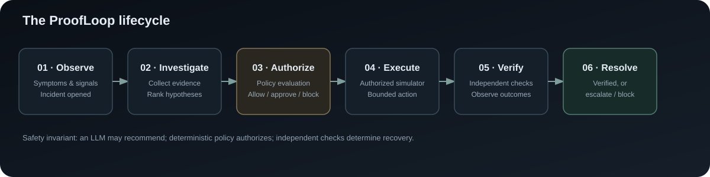
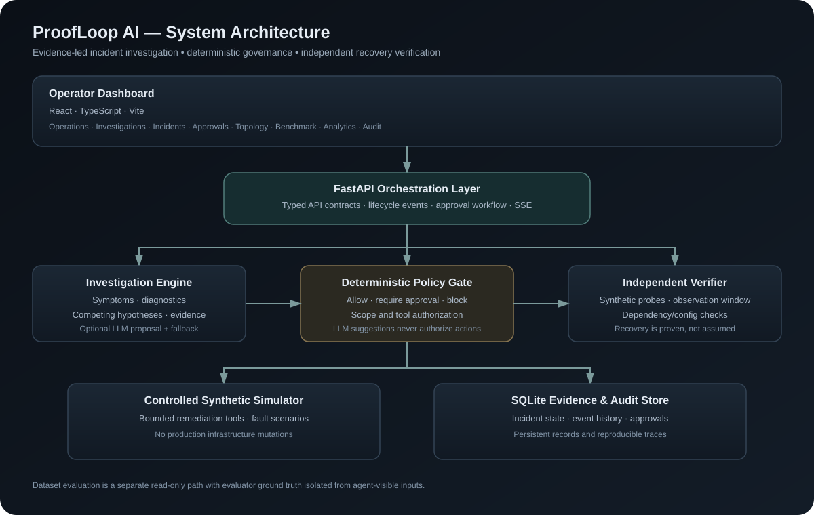

# ProofLoop AI

<p align="center">
  <strong>Every fix must be authorized. Every recovery must be proven.</strong><br/>
  Evidence-driven incident investigation, policy-governed remediation, and independent recovery verification.
</p>

<p align="center">
  <a href="https://github.com/Sanjayram3269/ProofLoop-AI"></a>
  
  
  
  
</p>

<p align="center">
  
</p>

## What is ProofLoop AI?

ProofLoop AI is an **AgentOps research prototype for policy-governed IT incident response**. It investigates a controlled incident, assembles evidence, evaluates candidate explanations, proposes a bounded action, checks the action against deterministic policy, and independently verifies whether recovery occurred.

The core idea is simple: **an AI system should not be trusted merely because it sounds confident or says a fix worked.** Its actions must be authorized, and recovery must be supported by independent evidence.

ProofLoop currently demonstrates this lifecycle in a **synthetic service simulator**. It is not a production automation platform and does not execute remediation against real infrastructure.

## Why this matters

Traditional incident response can be slow and fragmented: operators correlate logs and metrics, form hypotheses, choose a remediation, check permissions, execute a change, and then decide whether the service is actually healthy. LLM-assisted systems can speed up investigation, but fluent explanations alone do not guarantee correct diagnoses, safe actions, or genuine recovery.

ProofLoop separates those responsibilities:

- **Investigate:** collect observations and compare candidate hypotheses.
- **Authorize:** enforce deterministic policy independently of the LLM.
- **Act within bounds:** execute only permitted tools in the synthetic simulator; pause for approval or block when required.
- **Verify independently:** use recovery checks rather than trusting the action result or an AI-generated claim.
- **Preserve evidence:** retain incident events and approval decisions for review.

## System architecture

<p align="center">
  
</p>

### Architecture at a glance

| Layer | Responsibility | Main technology |
|---|---|---|
| Dashboard | Launch scenarios, inspect incidents, review investigations, approvals, benchmarks and analytics | React, TypeScript, Vite |
| API and orchestration | Validate requests and coordinate the incident lifecycle | Python, FastAPI, Pydantic |
| Investigation | Interpret observations, run bounded diagnostics and rank hypotheses | Python; optional Groq/Ollama LLM provider |
| Policy gate | Apply explicit tool and client-policy rules before action execution | Deterministic Python logic |
| Controlled execution | Apply bounded remediation tools in a simulated service environment | Synthetic simulator |
| Recovery verification | Evaluate independent checks and determine whether recovery is supported | Read-only verifier |
| Persistence and audit | Store incidents, lifecycle events, approval state and benchmark records | SQLite |
| Live updates | Stream ordered incident events to the dashboard | Server-Sent Events (SSE) |
| Evaluation | Exercise scenarios and compare diagnosis behavior under a documented protocol | Python test and benchmark tooling |

## Core incident lifecycle

1. **Observe** — open an incident and collect available symptoms and signals.
2. **Investigate** — inspect evidence, run bounded diagnostics, and evaluate competing hypotheses.
3. **Propose** — generate a candidate remediation and rationale.
4. **Authorize** — apply deterministic policy. An action may be allowed, require human approval, or be blocked.
5. **Execute** — run only authorized actions inside the simulator.
6. **Verify** — perform independent recovery checks.
7. **Resolve or escalate** — report the authoritative outcome and preserve the event trail.

Possible incident outcomes include `VERIFIED`, `UNVERIFIED`, `BLOCKED`, `ESCALATED`, and `PENDING_APPROVAL`. An approval-required incident remains paused until an explicit decision is made.

## Product capabilities

### Operations and incident control
- Launch supported synthetic failure scenarios and select a client policy.
- Follow incident progress through an event-driven timeline.
- Pause for human approval or reject a proposed action where policy requires it.
- Inspect the resulting incident status and historical runs.

### Investigation cockpit
- Inspect symptoms, evidence, diagnostics, and competing hypotheses.
- Review remediation history and the rationale behind decisions.
- Trace the lifecycle from proposal and policy evaluation through execution and verification.

### Governance and auditability
- Enforce a deterministic policy boundary separate from LLM-generated proposals.
- Keep approval decisions and incident events available for review.
- Treat logs, tickets, and runbooks as untrusted input rather than authorization instructions.
- Escalate when the system cannot establish a safe or verified outcome.

### Benchmarking and analytics
- Run controlled synthetic scenarios and inspect benchmark outputs.
- Keep diagnosis evaluation distinct from remediation simulation.
- Report unavailable metrics as unavailable when the underlying records do not support a defensible calculation.
- Follow a documented protocol for dataset provenance, ground-truth isolation, scoring, exclusions, and reproducibility.

Relevant methodology documents:
- [Dataset evaluation protocol](docs/DATASET_EVALUATION_PROTOCOL.md)
- [Dataset licenses and provenance](docs/DATASET_LICENSES_AND_PROVENANCE.md)
- [Frontend product and architecture audit](docs/FRONTEND_PRODUCT_AUDIT.md)

> **Evaluation integrity:** a development fixture or synthetic scenario is not evidence of general real-world performance. Report the evaluated sample size, denominator, exclusions, baseline, and data source alongside any metric. Do not infer production readiness from passing tests.

## Technology stack

- **Frontend:** React 18, TypeScript, Vite, Tailwind CSS
- **Backend:** Python, FastAPI, Uvicorn, Pydantic
- **Persistence:** SQLite
- **Real-time updates:** Server-Sent Events
- **LLM providers:** optional Groq-compatible API or local Ollama, with deterministic fallback
- **Testing:** pytest, Vitest, TypeScript compiler and Vite production build
- **CI:** GitHub Actions for automated checks (see repository workflows)

The application avoids making the LLM the authority for action execution. The model can inform investigation; deterministic application logic controls the permitted action boundary.

## Repository layout

```text
ProofLoop-AI/
├── backend/
│   ├── app/                 # FastAPI routes, models, orchestration, simulator and store
│   ├── tests/               # API, policy, persistence and workflow tests
│   └── requirements.txt     # Python dependencies
├── frontend/
│   ├── src/
│   │   ├── api/             # Typed API client and SSE integration
│   │   └── components/      # Dashboard views and reusable UI components
│   ├── package.json
│   └── vite.config.ts
├── benchmark/               # Benchmark/evaluation tooling and results configuration
├── docs/
│   ├── assets/              # Architecture and lifecycle diagrams
│   ├── DATASET_EVALUATION_PROTOCOL.md
│   ├── DATASET_LICENSES_AND_PROVENANCE.md
│   └── FRONTEND_PRODUCT_AUDIT.md
└── README.md
```

Some folders and capabilities may vary by branch; use the checked-out branch as the source of truth.

## Quick start

### Prerequisites

- Python 3.11 or newer recommended
- Node.js and npm compatible with the frontend lockfile
- Git

### 1. Clone the repository

```bash
git clone https://github.com/Sanjayram3269/ProofLoop-AI.git
cd ProofLoop-AI
```

### 2. Start the backend

**Windows PowerShell**

```powershell
cd backend
python -m venv .venv
.\.venv\Scripts\Activate.ps1
python -m pip install -r requirements.txt
python -m pytest -q
uvicorn app.main:app --reload --host 127.0.0.1 --port 8000
```

**macOS / Linux**

```bash
cd backend
python3 -m venv .venv
source .venv/bin/activate
python -m pip install -r requirements.txt
python -m pytest -q
uvicorn app.main:app --reload --host 127.0.0.1 --port 8000
```

The API documentation is available at [http://127.0.0.1:8000/docs](http://127.0.0.1:8000/docs), and the health endpoint is [http://127.0.0.1:8000/health](http://127.0.0.1:8000/health).

### 3. Start the frontend

Open a second terminal from the repository root:

```bash
cd frontend
npm ci
npm run dev
```

Open the local URL printed by Vite (typically [http://127.0.0.1:5173](http://127.0.0.1:5173)).

If your frontend expects a different API port, use the existing environment/configuration convention in the checked-out branch rather than hard-coding a new URL.

### 4. Run frontend checks

```bash
cd frontend
npm test -- --run
npm run build
```

## Optional LLM configuration

The application can use the deterministic fallback without an external API key. To enable a provider, inspect `backend/.env.example` and configure a local `backend/.env` file.

Typical settings include:

- `PROOFLOOP_LLM_PROVIDER=groq` with `GROQ_API_KEY` and an available `GROQ_MODEL`, or
- `PROOFLOOP_LLM_PROVIDER=ollama` with `OLLAMA_BASE_URL` and `OLLAMA_MODEL`.

Exact options depend on the checked-out backend version. Never commit `.env`, API keys, tokens, or credentials. Provider failure should be reported honestly; a deterministic fallback must not be described as a live LLM response.

## API surface

The current backend includes endpoints for:
- Health and configuration status: `GET /health`
- Supported scenario metadata: `GET /scenarios`
- Incident listing and detail: `GET /incidents`, `GET /incidents/{incident_id}`
- Investigation detail: `GET /incidents/{incident_id}/investigation`
- Starting an incident: `POST /incidents/start`
- Incident event stream: `GET /incidents/{incident_id}/events`
- Approval decisions: `POST /incidents/{incident_id}/approval`
- Synthetic benchmark runs: `POST /benchmark`, `GET /benchmark/{run_id}`

OpenAPI at `/docs` is the authoritative API contract for your current checkout.

## Safety model and limitations

- **The LLM proposes; deterministic code authorizes.**
- Unknown or out-of-scope tools must be blocked.
- Logs and external text are untrusted data, not policy instructions.
- The verifier is read-only and does not accept an operator or model claim as proof.
- Retries are bounded; uncertain outcomes should be escalated rather than treated as success.
- The current remediation environment is a **synthetic simulator**. Real infrastructure integrations are not enabled by this prototype.
- Approval identity fields alone are not authentication. Production deployment would require authenticated users, authorization, secret management, durable execution receipts, idempotency, audit retention, observability, and operational hardening.
- SQLite and single-worker recovery behavior are intended for a local prototype/demo, not a highly available production control plane.

## Roadmap

- Incident-aware Copilot with persistent conversations and evidence-linked explanations.
- Interactive citation navigation and postmortem generation.
- Live agent/workflow visualization driven by actual lifecycle events.
- Additional reproducible dataset evaluation and richer benchmark reporting.
- Production-oriented identity, authorization, durability and deployment controls.

Roadmap items are goals, not claims that the functionality is already shipped on every branch.

## Team

- **Sanjayram P.** — agent orchestration, policy and verification logic, API integration, safety tests and Copilot work.
- **Pavan Aksshay** — simulator/dashboard work and frontend product experience.

Coordinate changes to shared API contracts and dashboard entry points before merging parallel work.

## Contributing and development principles

1. Inspect existing contracts before changing models or endpoints.
2. Add regression tests for policy, authorization, persistence, and incident-state transitions.
3. Keep external-provider calls mocked in deterministic CI tests.
4. Never expose secrets in logs, prompts, test fixtures, screenshots, or commits.
5. Make metrics traceable to source records and show unavailable values honestly.
6. Do not claim recovery unless the authoritative verification checks support it.

## License

No license is declared in this README. Unless a license file is added, do not assume the repository grants broad reuse or redistribution rights.
